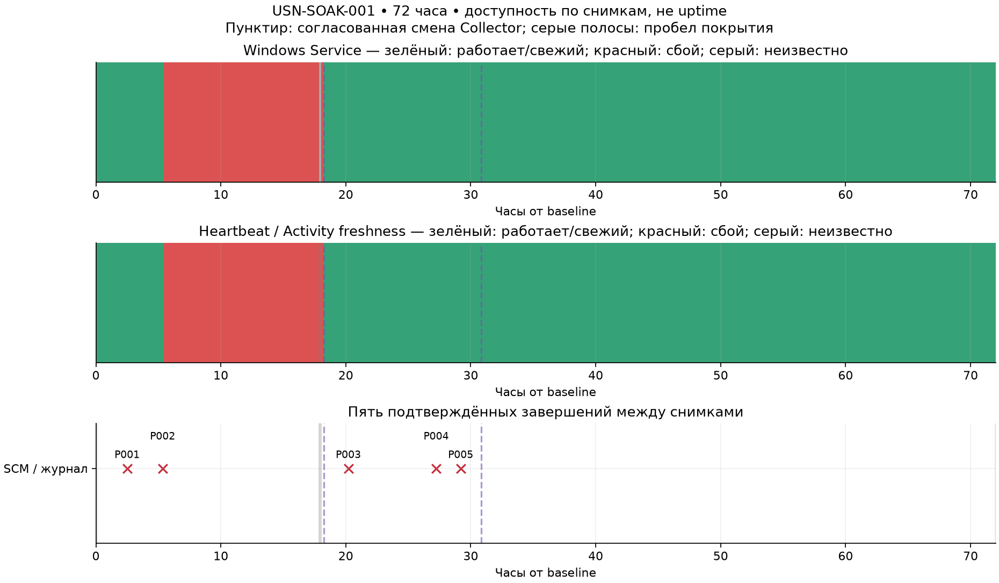
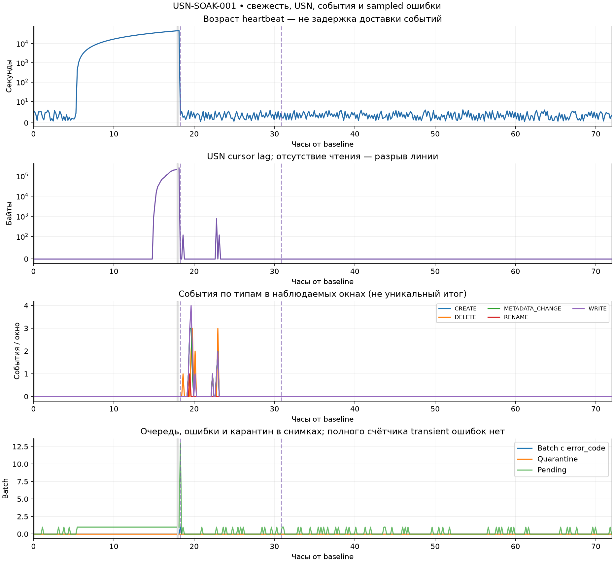
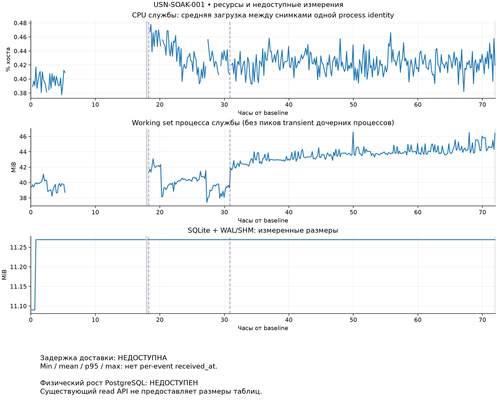

# USN-SOAK-001 — итоговый отчёт

**Результат исходного 72-часового окна: FAIL.** Подтверждены пять аварийных завершений Windows Service, включая длительный простой. После последнего согласованного исправления новых падений в доступном журнале и ошибок в снимках не обнаружено за 41,12 часа. Исправленная версия не прошла отдельное 72-часовое наблюдение; готовность к массовому развёртыванию не заявляется.

Это публичная обезличенная сводка наблюдения 8–11 октября 2026 года. Графики используют относительное время от baseline. Raw snapshots, системные журналы, внутренние пути, identities, параметры доступа и диагностические свидетельства остаются в приватном хранилище и не публикуются.

## Версии и метод

| Компонент | Проверенная версия |
| --- | --- |
| Collector на baseline | `385f427e18f93051eb98bc10c7f23089326b3792` |
| Первое согласованное исправление | `374a73f3f2237d0461cc96c32d9c1f13d34acc8a` |
| Последнее установленное исправление | `eb6312bd431f40ff86e522c621c41e885defc454` |
| Central API, неизменный в окне | `22667a67b6c5faceb914a114197e92b3a7bac2b7` |

Последний Collector проверен по хешам 104 установленных модулей; версия API — по метке работающего образа. Локальный Git HEAD не использовался как доказательство установленной версии. Последнее исправление опубликовано через [PR #21](https://github.com/BorisDruzak/storage-console/pull/21), merged main `87b12fea6c0b90165a4501dd9c6068354ab7bd28` с тем же деревом исходников.

Сбор каждые 10 минут выполнялся согласованным заданием на операторском компьютере без постоянно открытой сессии Codex. Обзоры каждые 5 часов использовали HTTPS Activity API, существующую collector-push телеметрию и разрешённые административные read-only проверки. Содержимое файлов и PostgreSQL напрямую не читались.

Внутри исходного окна были два отдельно согласованных обслуживания Collector. Baseline и deadline не сбрасывались. Автоматические проверки не меняли production, не выполняли rebaseline, не изменяли Journal/ACL/SMB/audit, не создавали тестовые файлы и не очищали очередь/locks/checkpoints.

## Подтверждённые проблемы

- Пять аварийных завершений службы; один простой продолжался около 12 часов 55 минут до согласованного восстановления.
- Первичные исключения первых двух завершений не сохранялись. Подтверждена причина отсутствия автоматического восстановления при втором завершении: SCM recovery action `NONE`.
- Три дальнейших завершения после первого исправления проходили через `OutboxError` при проверке SQLite sidecar; SCM восстанавливал службу примерно за 61 секунду.
- На синтетическом состоянии совпадающих версий Python/SQLite воспроизведена гонка удаления обычного rollback journal. Атрибуты файлов в момент исторических production отказов не сохранены, поэтому точный низкоуровневый триггер каждого отказа ретроспективно не доказан.

Последнее исправление добавило ограниченную повторную проверку исчезающего Windows journal и ограниченный retry inventory writer при `BUSY`/`LOCKED`. Проверки небезопасных файлов сохранены. Эти изменения не превращают исходный FAIL в PASS.

## Покрытие и доступность

Сохранено 465 снимков внутри окна; полностью прочитано **431 из 432 десятиминутных слотов (99,77%)**. Один слот неполон во время первого обслуживания. Начальная задержка до первого успешного фонового снимка — 443,4 секунды; ненаблюдаемый хвост перед deadline — 155,9 секунды. Пропуски не заполнены вымышленными данными.

Служба: 384 снимка `Running`, 79 `Stopped`, 2 `UNKNOWN`. Freshness: 382 `HEALTHY`, 81 `CRITICAL`, 2 `UNKNOWN`. Это число снимков, **не процент uptime**: дополнительные проверки неравномерны, а короткие аварии между снимками подтверждались журналом. Ошибки чтения включают две начальные API HTTP429 и две недоступности Windows-проверки при обслуживании. HTTP429 наблюдателя не доказывает сбой HTTPS доставки Collector. Missing/stale данные не считаются healthy.

## События, очередь и USN

| Тип | Сумма в наблюдаемых окнах |
| --- | --- |
| METADATA_CHANGE | 15 |
| WRITE | 18 |
| CREATE | 15 |
| DELETE | 13 |
| RENAME | 1 |

Окна могут перекрываться и пропускать поздние поступления: суммы не являются точным уникальным итогом. В доступных выборках не обнаружено дубликатов `source_event_id`; усечённых окон нет. Полная транзакционная проверка всех событий интерфейсом не обеспечена.

Максимальный sampled pending — 22 batch, quarantine — 0. Две записи `SERVER_ERROR` отражают одно временное состояние после первого обслуживания; очередь затем доставлена. USN status error codes в снимках не обнаружены. Проверялись `USN_LAG`, `CONTINUITY_GAP`, `USN_PATH_UNKNOWN`, `USN_CAPACITY`, `USN_STALE`, `NATIVE_FAILED`; полного исторического счётчика кратковременных ошибок нет.

После последнего исправления собрано 262 снимка за **41,12 часа**: одна process identity, `Running`/`HEALTHY` во всех доступных снимках, journal/cursor валидны, lag0, quarantine0, batch errors0, новых аварий в доступном журнале0. USN cursor/revision продвигались естественно. Нулевые scoped Activity события при свежем heartbeat и USN proof не считались остановкой USN. Этот период преимущественно малонагруженный, без искусственных production тестов.

## Ресурсы и доступные статистики

| Метрика всего окна | min | mean | p95 | max |
| --- | --- | --- | --- | --- |
| Возраст heartbeat, s | 0,627 | 4169,411 | 34032,817 | 46036,181 |
| RAM службы, MiB | 37,418 | 42,535 | 45,051 | 46,570 |
| CPU между снимками, % хоста | 0,371 | 0,424 | 0,458 | 0,624 |
| SQLite + sidecars, bytes | 11628544 | 11814111,378 | 11816960 | 11816960 |
| USN lag, bytes | 0 | 4881,918 | 120 | 245640 |
| Задержка доставки событий | недоступно | недоступно | недоступно | недоступно |

CPU — средняя доля ёмкости хоста между снимками с одинаковыми PID/start time. RAM — основной процесс службы; пики дочерних процессов не измерены. SQLite вырос на 188416 bytes; после последнего исправления размер оставался неизменным. Снимки не доказывают отсутствие кратковременных пиков.

## Ограничения и завершение

В последнем снимке служба `Running`, exit0, heartbeat `HEALTHY`, pending/quarantine отсутствуют, auth не приостановлен, USN cursor/journal валидны, lag0. Инвентаризация свежая.

Min/mean/p95/max задержки доставки недоступны: Activity API не предоставляет per-event `received_at`. Возраст heartbeat и время наблюдения не подменяют delivery latency. Физический рост таблиц PostgreSQL недоступен через существующий read API; напрямую БД не читалась.

Общий результат остаётся **FAIL**. Для последней версии подтверждена стабильность только в наблюдавшемся периоде и режиме нагрузки; отдельный 72-часовой PASS не присвоен. Промежуточные отчёты за 24/48 часов и полный итог со свидетельствами сохранены приватно. Пятичасовая автоматизация приостановлена после итогового отчёта; новый цикл автоматически не запускался.
